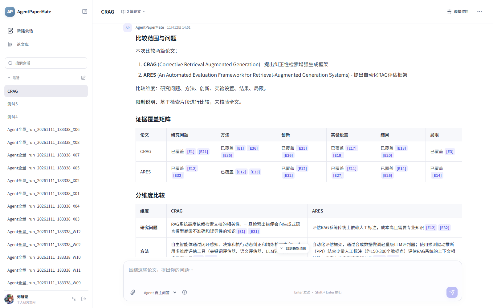
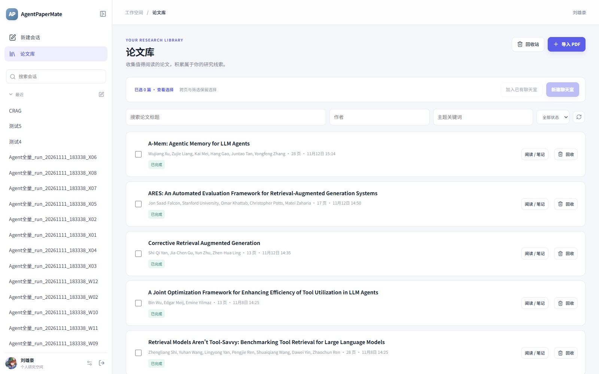
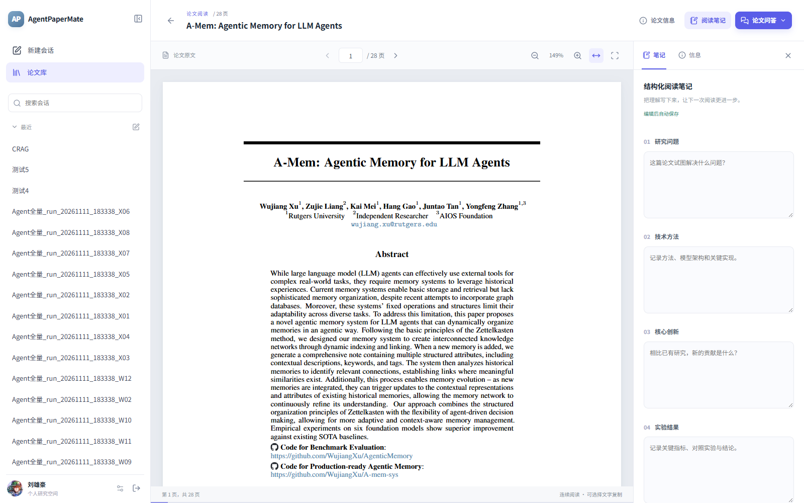
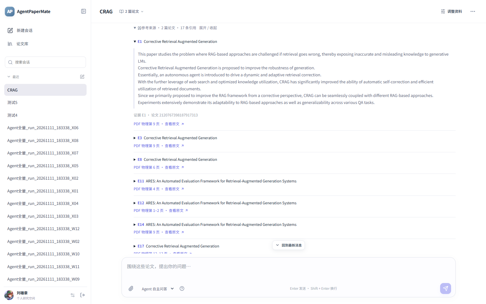
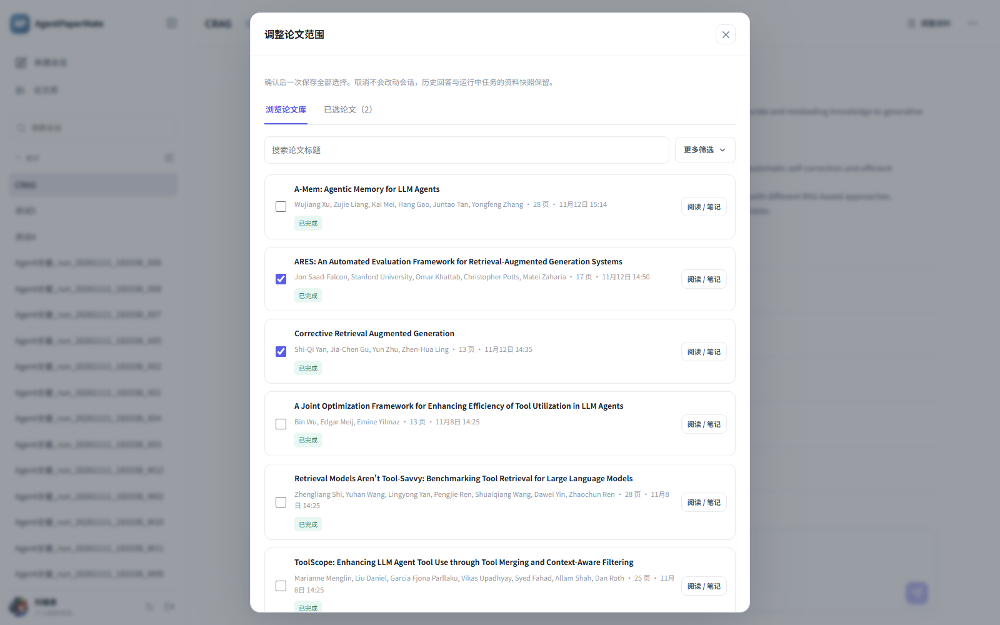
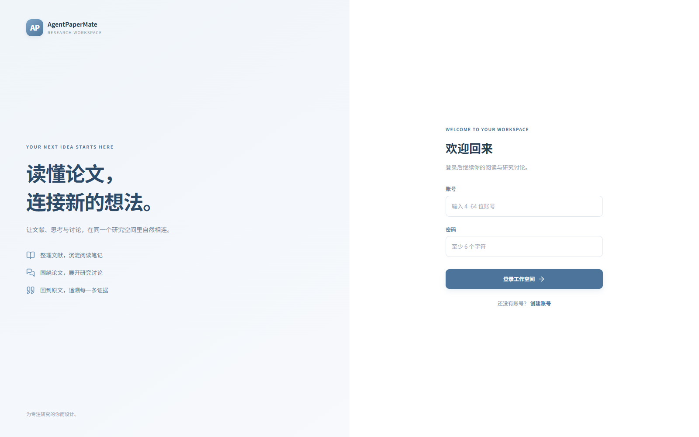
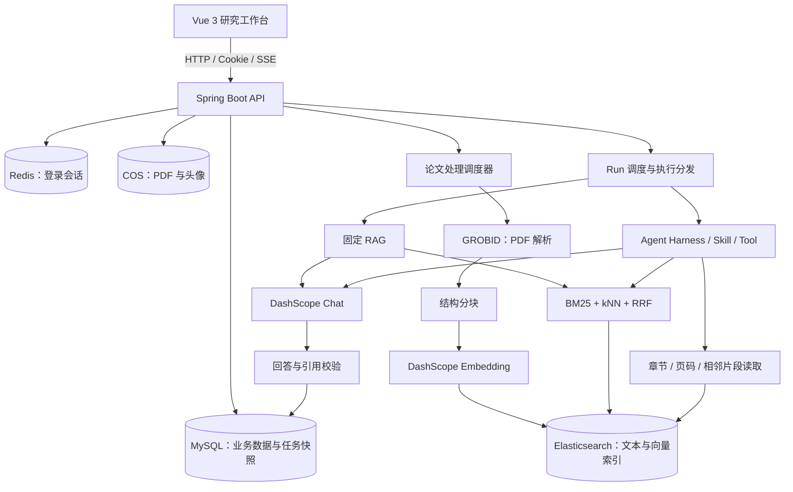

# AgentPaperMate

**读懂论文，连接新的想法。**

AgentPaperMate 是一个面向科研阅读的 AI 论文工作台，基于 **Spring Boot + Spring AI + Vue 3** 构建。将 PDF 文献管理、原文阅读、结构化笔记、RAG 检索问答与 Agent 研究助手整合到同一个工作空间，让回答能够通过引用回到论文原文。

上传论文后，系统自动完成解析、分块和向量索引；选择本次讨论的论文范围，即可进行论文问答、单篇总结、多篇比较与研究方向分析。



> 本文图片于 2026-11-12 使用 Chrome 从本地运行的正式应用截取，展示已有论文与历史问答数据。

## 目录

- [功能特性](#功能特性)
- [界面预览](#界面预览)
- [技术栈](#技术栈)
- [系统架构](#系统架构)
- [Agent 技能与工具](#agent-技能与工具)
- [本地运行](#本地运行)
- [使用流程](#使用流程)
- [项目结构](#项目结构)
- [接口与验证](#接口与验证)
- [部署说明与使用边界](#部署说明与使用边界)

## 功能特性

| 模块 | 功能 |
| --- | --- |
| 账号与工作空间 | 注册、登录、退出、个人资料维护；使用 Cookie / Redis Session 认证，按用户隔离论文和会话 |
| 论文库 | PDF 上传、标题 / 作者 / 主题 / 状态筛选、分页与跨页选择、处理进度、失败重试、回收站与恢复 |
| 论文处理 | GROBID 提取元数据与正文结构，按章节分块，生成 Embedding 并写入 Elasticsearch |
| PDF 阅读 | PDF.js 原文渲染、翻页、缩放、专注阅读、物理页码定位 |
| 阅读笔记 | 研究问题、技术方法、核心创新、实验结果等六个字段，自动保存、版本冲突保护及导出 |
| 研究会话 | 创建、搜索、切换、重命名和删除会话，保存输入草稿，查看历史消息，导出完整 Markdown 聊天记录 |
| 资料范围 | 为每个会话选择论文，完整集合提交与版本校验；每次任务保存资料快照 |
| RAG 问答 | Elasticsearch BM25 + kNN 双路检索，RRF 排名融合，基于证据生成带引用的回答 |
| Agent 助手 | 根据问题选择技能，自主调用论文工具，执行多轮检索与定位读取，展示技能和工具执行进度 |
| 引用溯源 | 正文引用编号、原文摘录、章节 / 来源位置、PDF 物理页码跳转 |
| 任务管理 | 幂等创建、后台调度、SSE 进度事件、事件补发与查询恢复、取消、超时及调用预算控制 |

## 界面预览

### 论文库

集中管理研究文献，查看解析状态，并将所选论文加入新的或已有的研究会话。



### 原文阅读与笔记

在同一个页面阅读 PDF、记录结构化笔记，并随时进入论文问答。



### 引用与证据

展开回答的参考来源，查看原文摘录，再通过物理页码回到 PDF 核查。



<details>
<summary>查看更多：资料范围与登录界面</summary>

为当前会话调整论文范围，确认后保存，取消则保留原范围。





</details>

## 技术栈

| 层次 | 技术 |
| --- | --- |
| 前端 | Vue 3.5、TypeScript 5.9、Vite 7、Vue Router 4、Pinia 3、Axios |
| 内容展示 | PDF.js、Marked、DOMPurify、KaTeX、Lucide |
| 后端 | Java 21、Spring Boot 3.4.2、MyBatis-Plus 3.5.18 |
| AI 接入 | Spring AI 1.0.0-M6、Spring AI Alibaba 1.0.0-M6.1、DashScope 原生 API |
| 默认模型配置 | `qwen3.7-plus`；`qwen3.7-text-embedding`，1024 维 |
| 数据与存储 | MySQL、Redis / Spring Session、Elasticsearch、腾讯云 COS |
| 文档解析 | GROBID，解析器版本配置为 `0.9.1-crf` |
| API 文档 | Knife4j、Springdoc OpenAPI |
| 测试 | Spring Boot Test、Vitest、Playwright |

版本与默认值以 [pom.xml](pom.xml)、[package.json](frontend/package.json) 和 [application.yml](src/main/resources/application.yml) 为准。模型服务需自行开通，并与所配置的模型及维度匹配。

## 系统架构



### 论文入库

`上传 PDF → COS 存储 → 创建处理任务 → GROBID 解析 → 结构分块 → 向量化 → ES 写入与校验 → 发布可用索引`

处理任务保存解析器、分块规则、模型及索引配置快照。后台通过租约、续约和独立执行尝试隔离重复领取与过期执行者；索引验证成功后才发布论文的可用版本。

### 两种回答模式

| | RAG 检索问答 | Agent 自主问答 |
| --- | --- | --- |
| 执行方式 | 固定的检索、证据筛选、生成流程 | 技能约束下的模型与工具多轮循环 |
| 资料获取 | BM25 与向量双路检索，RRF 融合 | 按需检索，也可读取章节、页码和相邻片段 |
| 适用问题 | 针对原文的事实查询与解释 | 结构化总结、多论文比较、需要补充取证的分析 |
| 共同机制 | 资料范围与归属校验、证据快照、引用校验、任务事件、取消与超时 | 同左 |

Run 创建时固定资料与配置；Agent 还保存 Skill 的版本、内容哈希与完整快照。后续配置变动不会悄悄替换已创建任务的技能内容。浏览器断线后可以补发事件或查询任务状态，最终回答与引用由后端保存。

## Agent 技能与工具

Agent 根据**当前问题的规则匹配**选择技能，未命中时回退论文问答。技能资源随应用打包在 [agent-skills](src/main/resources/agent-skills) 中。

| 技能 | 用途 | 示例问题 | 范围 |
| --- | --- | --- | --- |
| `paper-qa` | 基于原文回答问题 | “这篇论文如何评估检索质量？” | 当前会话论文 |
| `paper-summary` | 结构化总结研究问题、方法、实验与局限 | “请总结这篇论文” | 恰好 1 篇 |
| `paper-comparison` | 多维度比较并组织证据覆盖矩阵 | “请比较这些论文的方法、实验结果与局限” | 2～5 篇 |
| `research-analysis` | 分析研究方向，组织假设与实验建议 | “请分析这些论文的研究方向，提出可验证的假设与实验方案” | 当前会话论文 |

可用的六个只读论文工具：

| 工具 | 用途 |
| --- | --- |
| `get_paper_metadata` | 获取论文元数据 |
| `search_paper_chunks` | 检索当前范围内的论文片段 |
| `list_paper_sections` | 列出已索引片段中的章节信息 |
| `read_paper_section` | 按章节读取片段 |
| `read_paper_page` | 按 PDF 物理页码读取匹配片段 |
| `read_neighbor_chunks` | 补充已有证据的相邻上下文 |

工具执行受服务端白名单、论文归属、任务范围、超时和调用预算约束。技能中的输出模板引导回答结构；证据是否充分、比较是否完整，仍需结合原文判断。

## 本地运行

以下命令以仓库根目录 `AgentPaperMate/` 为起点。

### 1. 准备环境

| 依赖 | 要求 / 用途 |
| --- | --- |
| JDK | 21 |
| Maven | 3.9.x，示例命令使用本机 `mvn` |
| Node.js | 22.13+ 或 24 LTS，安装前端依赖与构建 |
| MySQL | 8.0.16 及以上的 8.x，保存业务数据 |
| Redis | 可从后端访问，用于登录 Session |
| Elasticsearch | 8.x，需与项目客户端兼容，支持向量检索 |
| GROBID | 可访问的解析服务，配置版本需与部署版本对应 |
| 腾讯云 COS | 已创建的 Bucket 和可用访问凭据 |
| DashScope | 可用的原生 API 地址、密钥及模型权限 |

### 2. 初始化数据库

从仓库根目录进入 MySQL 客户端：

```bash
mysql -h 127.0.0.1 -P 3306 -u root -p
```

在客户端中执行：

```sql
CREATE DATABASE apm CHARACTER SET utf8mb4 COLLATE utf8mb4_0900_ai_ci;
USE apm;
SOURCE sql/create_table.sql;
```

[建表脚本](sql/create_table.sql) 用于空数据库，包含用户、论文、会话、阅读笔记、任务、消息、引用和事件等 10 张表。已有数据库需先核对表结构，不能重复执行整份建表脚本。

### 3. 配置后端

默认启用 `dev` Profile。在 `src/main/resources/` 下创建 `application-dev.yml`，按实际环境填写；该文件已被 Git 忽略。也可从提供的无密钥模板复制：

```powershell
# 已有本地配置时直接编辑，不覆盖现有文件。
Copy-Item docs/application-dev.example.yml src/main/resources/application-dev.yml
```

模板包含以下配置：

| 配置前缀 | 需要填写的内容 |
| --- | --- |
| `apm.datasource` | MySQL JDBC URL、用户名、密码与驱动 |
| `apm.data.redis` | Redis 地址、端口、密码及 `ttl` |
| `apm.elasticsearch` | ES 地址、用户名与密码 |
| `apm.grobid.url` | GROBID 服务地址，例如 `http://127.0.0.1:8070` |
| `apm.dashscope` | 原生 API 主机地址与 API Key |
| `cos.client` | COS 访问域名、SecretId、SecretKey、Region 和 Bucket |

DashScope 的 `base-url` 填原生服务主机地址，客户端会追加请求路径；不要填写 `/compatible-mode/v1`。示例中的 `${...}` 需要通过环境变量提供，或在本地配置中替换为实际值，不能将真实密钥提交到仓库。

当前 [application.yml](src/main/resources/application.yml) 已启用 `paper.processing.pipeline.enabled` 与 `rag.enabled`。完整体验需要上述外部服务均可访问。只调试基础页面时，可在本地配置中将这两个开关设为 `false`；数据库、Session 和其他必要配置仍需准备。

### 4. 启动后端

```bash
mvn spring-boot:run
```

默认后端地址：[http://localhost:8123/api](http://localhost:8123/api)。接口文档：[Knife4j](http://localhost:8123/api/doc.html)。

### 5. 启动前端

另开一个终端：

```bash
cd frontend
npm ci
npm run dev
```

打开 [http://127.0.0.1:5173](http://127.0.0.1:5173)。Vite 将 `/api` 请求代理到 `http://localhost:8123`，登录 Cookie 和 SSE 使用同源访问。

如需修改代理，在 `frontend/.env.local` 中配置并重启 Vite：

```dotenv
VITE_API_BASE_URL=/api
API_PROXY_TARGET=http://localhost:8123
```

`API_PROXY_TARGET` 仅填写后端 origin，不追加 `/api`。`npm run dev` 和 `npm run build` 会自动准备 PDF.js 所需的字体、CMap 与 WASM 资源。

## 使用流程

1. **创建账号并登录**：首次使用在登录页选择“创建账号”。
2. **导入 PDF**：进入论文库上传论文，等待解析、向量化和索引发布完成。
3. **阅读与记录**：打开论文原文，在侧栏维护结构化阅读笔记。
4. **建立研究会话**：选择论文创建聊天室，或在会话中通过“调整资料”设置范围。
5. **选择回答模式**：使用 RAG 查询具体事实，或使用 Agent 进行总结、比较和研究分析。
6. **检查证据**：展开正文引用，阅读摘录，并跳转 PDF 物理页码核查结论。
7. **沉淀成果**：导出笔记或完整聊天记录，继续下一轮研究。

新上传的论文不会自动加入已有会话。调整资料后，后续问题使用新范围，历史回答保留原有证据。只有通过后端 `canAsk` 检查的论文才能参与问答。

## 项目结构

```text
AgentPaperMate/
├── frontend/
│   ├── src/
│   │   ├── api/                 # HTTP 请求与业务 API
│   │   ├── components/          # PDF、笔记、引用、资料范围与执行进度
│   │   ├── composables/         # 聊天状态与异步生命周期
│   │   ├── pages/               # 登录、论文库、阅读、聊天与个人设置
│   │   ├── stores/              # 用户与会话状态
│   │   └── utils/               # SSE 恢复、Markdown 与格式化
│   ├── tests/                   # Vitest 与 Playwright 测试
│   └── docs/                    # 前端对接及界面设计说明
├── src/main/java/com/ecnu/agentpapermate/
│   ├── agent/                   # Harness、Skill 路由、工具与证据上下文
│   ├── config/                  # 数据源、AI、任务与存储配置
│   ├── controller/              # REST API 与事件入口
│   ├── ingestion/               # GROBID 解析、分块、租约与向量写入
│   ├── rag/                     # 混合检索、证据组织与回答生成
│   ├── scheduler/               # 论文处理与问答任务调度
│   ├── service/                 # 业务服务及 Run 执行器
│   └── validator/               # 回答与引用校验
├── src/main/resources/
│   ├── agent-skills/            # 四种技能及其参考模板
│   └── application.yml          # 公共配置与默认参数
├── src/test/                    # 后端测试及测试资源
├── sql/create_table.sql         # MySQL 初始化表结构
├── docs/                       # 后端设计说明、配置模板与截图
└── pom.xml
```

## 接口与验证

### 主要接口

所有路径均包含后端上下文 `/api`；业务响应使用统一 `BaseResponse`，客户端需要检查响应体中的 `code`。

| 模块 | 接口示例 |
| --- | --- |
| 认证 | `POST /api/appUser/register`、`POST /api/appUser/login` |
| 文件与论文 | `POST /api/common/upload/paper`、`POST /api/paper/add`、`POST /api/paper/list/page` |
| 原文 | `GET /api/paper/get`、`GET /api/paper/file` |
| 处理任务 | `GET /api/paperProcessingJob/get`、`POST /api/paper/retry` |
| 会话与范围 | `POST /api/chatSession/add`、`POST /api/sessionPaper/updateScope` |
| 笔记 | `GET /api/readingNote/get`、`POST /api/readingNote/update` |
| 问答任务 | `POST /api/agentRun/add`、`GET /api/agentRun/get`、`POST /api/agentRun/cancel` |
| 任务事件 | `GET /api/agentRun/events`（SSE）、`GET /api/runEvent/list`（补发查询） |
| 消息与引用 | `GET /api/chatMessage/list/page`、`GET /api/messageCitation/list` |
| 评测采集 | `GET /api/agentRun/evaluation`，读取已保存的执行数据 |

创建问答任务的请求体示例：

```json
{
  "sessionId": "已有会话的 ID",
  "requestKey": "唯一请求键，例如 UUID",
  "question": "请比较这些论文的方法、实验结果与局限",
  "executorType": "agent"
}
```

`executorType` 接受 `rag` 或 `agent`，省略时使用 `rag`。同一会话中使用相同请求键重发相同请求会返回原任务；主动重新执行问题则使用新的请求键。ID 在前端按字符串处理。

### 验证命令

后端在仓库根目录执行：

```bash
mvn test
mvn -DskipTests package
```

前端在 `frontend/` 执行：

```bash
npm test
npm run build
```

`npm run build` 包含 TypeScript 类型检查。浏览器测试可指定本机 Chrome：

```powershell
$env:PLAYWRIGHT_CHROMIUM_EXECUTABLE = 'C:\path\to\chrome.exe'
npm run test:e2e
```

测试分为本地替身验证和显式启用的真实服务联调，环境要求见测试代码与[前端说明](frontend/README.md)。本 README 的截图验证覆盖真实登录、论文列表、PDF 渲染、历史回答、引用展示与资料范围界面；截图过程未发起新的模型问答。测试命令列出的是复现入口，不代表本次文档更新重新执行了全部测试。

## 部署说明与使用边界

前端 `npm run build` 生成 `frontend/dist/`，后端可通过 `mvn -DskipTests package` 构建 JAR。生产环境建议同源部署：静态资源提供 history fallback，将 `/api` 反向代理到 Java 服务，并关闭 SSE 缓冲。完整 Nginx 示例见[前端部署说明](frontend/README.md#生产部署)。`npm run preview` 不提供开发环境的 API 代理。

- 单个 PDF 上传上限为 **50 MB**。解析能力依赖 GROBID，当前没有扫描件 OCR 流程；复杂表格、公式与缺失页码可能影响证据覆盖。
- 当前默认每次问答最多选择 **50 篇**论文；单篇总结和多论文比较另有前述范围限制。
- 引用页码对应 **PDF 物理页**，可能与论文印刷页码不同。未检索到证据不能推断论文未讨论该问题。
- 改变 Embedding 模型或维度需要同步调整索引与处理配置，并重新入库；不能直接混用旧向量。当前 Alibaba SDK 的维度选项不直接发送为服务端 `dimension` 参数，实际返回维度必须匹配配置。
- SSE 断线不等于取消任务。前端可恢复订阅和查询；后端进程重启不支持继续执行已经处于 `running` 状态的模型循环。
- 项目提供执行数据采集接口；当前前端没有独立评测看板。

进一步阅读：[会话管理](docs/chat-session.md) · [论文读取与资料范围](docs/paper-read-and-scope.md) · [论文处理调度](docs/paper-job-scheduler.md) · [RAG 与 Run](docs/rag-runs.md) · [Agent 循环](docs/agent-loop.md) · [技能设计](docs/agent-skills.md) · [论文定位工具](docs/paper-reading-tools.md)。这些文档包含分阶段开发记录，当前能力及默认配置以代码为准。
